# AwesomeOS Agent Platform (`awesome-os/agent-platform`)

> **The Sovereign, Zero-Dependency AI & Autonomous Agent Platform** — unifying **Foundation Models & Sub-1-Bit / Micro-MoE Runtimes**, **Boundary-Verified MoE Gates**, **ZER0Q Sub-ms CAS/KV Substrate**, **AtlasKV Hierarchical Memory (`25.1×` faster / `-98.2%` VRAM)**, **LLM & LoRA Studio**, **Persistent Multi-UI Agent Host**, **Model Armor Governance**, and **A2A / MCP / A2UI / x402** protocols atop `B8G_ABI_MAGIC_V3` (`0x33564742`) and Holo `v11` CAS.

[](https://b8g.dev/awesome-os/apps/agent-platform.html)
[](https://b8g.dev/awesome-os/apps/llm-studio.html)
[](https://b8g.dev/awesome-os/apps/agent-host.html)
[](https://b8g.dev/awesome-os/apps/oversight.html)
[](.github/workflows/ci.yml)
[](models/README.md)

---

## Architecture

```mermaid
flowchart LR
    subgraph MR["1. Models & Runtime"]
        M1["Model Garden & Ops IR<br/>(Inkling 2 Mini, Xenon 1B,<br/>LittleBit, Micro-MoE 53 KB,<br/>SpinWave, LumiBERT)"]
        M2["Inference Runtimes<br/>(Colibri, llama.cpp, vLLM,<br/>Hardware-Fit)"]
    end

    subgraph BLD["2. Build"]
        B1["LLM & LoRA Studio<br/>(InfoNCE, Matryoshka, Unsloth,<br/>GGUF, Colab GPU Mesh)"]
        B2["Memory & Recipes<br/>(AtlasKV HiKVP, Brain RAG,<br/>Pinokio v11 CAS Recipes)"]
    end

    subgraph PRO["3. Protocols"]
        P1["A2A · MCP · A2UI &lt;b8g-*&gt;<br/>· x402 BaaS Payments"]
    end

    subgraph SCL["4. Scale"]
        S1["ZER0Q CAS/KV Substrate<br/>(SKIMMER &lt;2ms Short-Circuit,<br/>DEADHAND Leases)"]
        S2["Persistent Agent Host (:7498)<br/>&amp; Durable SSE Sessions"]
    end

    subgraph GOV["5. Govern"]
        G1["Boundary-Verified MoE Gate<br/>(L2 Bounds, Quarantine,<br/>CapabilityToken)"]
        G2["Ed25519 Verified Registry,<br/>Gateway Policy &amp; Model Armor"]
    end

    subgraph OPT["6. Optimize"]
        O1["Algebraic Error-Loop LSP<br/>(Bounded K-Pass Convergence)"]
        O2["Eval, Simulation, NDJSON<br/>&amp; 3 ms Crystallization"]
    end

    subgraph DSH["7. Dashboards"]
        D1["Unified Control Center<br/>(LLM Studio, Agent Host,<br/>Sectium Shell, Oversight,<br/>Host Manager)"]
    end

    MR --> BLD --> PRO --> SCL --> GOV --> OPT --> DSH
```



---

## Getting Started & Live Dashboards

All dashboards are zero-dependency static HTML bundles built deterministically from TypeScript tagged templates (`dashboards/build-dashboards.mts`) and served live at **`b8g.dev`**:

- **Unified Agent Platform Control Center:** [dashboards/index.html](dashboards/index.html) ([Live Portal](https://b8g.dev/awesome-os/apps/agent-platform.html)) — dark-glass navigation rail switching across Architecture Overview, LLM Studio, Agent Host, Sectium Shell, Oversight Telemetry, and Fleet Host Manager.
- **Sovereign LLM & LoRA Studio (`:7497`):** [dashboards/llm-studio.html](dashboards/llm-studio.html) ([Live App](https://b8g.dev/awesome-os/apps/llm-studio.html)) — generated from [packages/llm-studio/ui-html.mts](packages/llm-studio/ui-html.mts).
- **Persistent Multi-UI Agent Host (`:7498`):** [dashboards/agent-host.html](dashboards/agent-host.html) ([Live App](https://b8g.dev/awesome-os/apps/agent-host.html)) — generated from [packages/agent-host/ui-html.mts](packages/agent-host/ui-html.mts).
- **Sectium Unified Interaction Shell:** [dashboards/sectium-shell.html](dashboards/sectium-shell.html) — generated from [packages/agent-host/sectium-shell-html.mts](packages/agent-host/sectium-shell-html.mts).
- **Holo `v11` Live Oversight Telemetry:** [dashboards/oversight.html](dashboards/oversight.html) ([Live App](https://b8g.dev/awesome-os/apps/oversight.html)) — planetary CAS & upstream library tracker.
- **Fleet Host Manager Console:** [dashboards/host-manager.html](dashboards/host-manager.html) — 4-column device & MDM control plane.
- **Dashboard Materializer & CI:** [dashboards/build-dashboards.mts](dashboards/build-dashboards.mts) · [package.json](package.json) · [.github/workflows/ci.yml](.github/workflows/ci.yml).

```bash
# Node 24+ native TypeScript (zero build/transpile step, zero npm runtime deps)
npm run build:dashboards
npm test
npm run tutorials
```

---

## Foundation Models & Sovereign Model Garden

Unified in the [AwesomeOS Model Architecture Atlas](models/README.md) and indexed in [packages/models-hub/models-manifest.json](packages/models-hub/models-manifest.json):

- **Inkling 2 Mini (Looped MoE Transformer):** `26.4B` total / `3.4B` base (`5.4B` effective) active via `3×` looped core (`24 → 48` logical layers), Block Attention Residuals, `1M` hybrid context, NVFP4+MXFP8, and DSpark speculator — [models/01-inkling-2-mini-looped-moe.md](models/01-inkling-2-mini-looped-moe.md).
- **B8G Xenon 1B / Kalaschnikow:** Asymmetric layer-wise tapered cognitive core under strict IsoFLOP parity (`C ≈ 6ND`), `16×16` block-sparse pruning, `B8G_ARENA_V1` 64B-aligned memory, and Chinchilla scaling extrapolator — [models/02-b8g-xenon-1b-kalaschnikow-atlaskv.md](models/02-b8g-xenon-1b-kalaschnikow-atlaskv.md) · [packages/kalaschnikow-xenon/README.md](packages/kalaschnikow-xenon/README.md) · [packages/kalaschnikow-xenon/src/index.mts](packages/kalaschnikow-xenon/src/index.mts).
- **LittleBit / NanoQuant (`0.1–0.5 BPW`):** Dual-SVID low-rank 1-bit binary factorization (`W ≈ U S V^T`), Joint-ITQ rotation, and ADMM PTQ fitting a `13B` model in `< 0.9 GB` for always-resident edge routers — [models/03-sub-1-bit-littlebit-nanoquant.md](models/03-sub-1-bit-littlebit-nanoquant.md).
- **Boundary-Verified MoE Blueprint:** Section-per-Expert MoE combining looped cores, Block Attention Residuals, AtlasKV, and ingress/egress boundary gates — [models/04-boundary-verified-moe-blueprint.md](models/04-boundary-verified-moe-blueprint.md).
- **Micro-MoE (`53.74 KB` INT8):** Cache-resident 5-head OS algebra & intent router achieving `100.00%` held-out validation accuracy in `0.682 ms` on CPU with Bloom-filter OOD gating — [packages/micro-moe/PAPER.md](packages/micro-moe/PAPER.md) · [packages/micro-moe/train-router.mts](packages/micro-moe/train-router.mts) · [packages/micro-moe/infer.mts](packages/micro-moe/infer.mts).
- **App-Dedup Classifier (`41.20 KB` INT8):** 3-head filesystem/installation deduplication classifier achieving `97.62%` held-out accuracy and `< 1 ms` latency with active-learning proposals — [packages/app-dedup-classifier/path-model.mts](packages/app-dedup-classifier/path-model.mts) · [packages/app-dedup-classifier/scanner.mts](packages/app-dedup-classifier/scanner.mts).
- **SpinWave Neuromorphic MoE:** Zero-copy magnonic phasor superposition bus over `SharedArrayBuffer` (`B8G_ABI_MAGIC_V3 = 0x33564742`) with seqlock epoch reads and Gilbert damping — [packages/spinwave-moe/index.mts](packages/spinwave-moe/index.mts) · [packages/spinwave-moe/spinwave-moe.mts](packages/spinwave-moe/spinwave-moe.mts) · [packages/spinwave-moe/dag-engine.mts](packages/spinwave-moe/dag-engine.mts).
- **LumiBERT (`2.8 ms`):** Ultra-fast local transformer encoder for inline IDE/shell error classification and embedding retrieval — [packages/lumi-bert/index.mts](packages/lumi-bert/index.mts).
- **Colibri Runtime Bridge:** Holo `v11` runtime bridge for Colibri local MoE execution — [runtime/colibri/AWESOME-OS-INTEGRATION.md](runtime/colibri/AWESOME-OS-INTEGRATION.md) · [runtime/colibri/colibri-v11-bridge.mts](runtime/colibri/colibri-v11-bridge.mts).
- **llama.cpp (`v11` Lock):** Native GGUF inference & quantization integration pinned to Holo `v11` — [runtime/llama-cpp/AWESOME-OS-INTEGRATION.md](runtime/llama-cpp/AWESOME-OS-INTEGRATION.md) · [runtime/llama-cpp/v11-max-lock.json](runtime/llama-cpp/v11-max-lock.json).
- **vLLM (`v11` Lock):** High-throughput GPU/ROCm/Vulkan model serving pinned to Holo `v11` — [runtime/vllm/AWESOME-OS-INTEGRATION.md](runtime/vllm/AWESOME-OS-INTEGRATION.md) · [runtime/vllm/v11-max-lock.json](runtime/vllm/v11-max-lock.json).
- **Hardware-Fit Recommender:** Probes CPU cores, RAM, and disk space to recommend local OS profiles and LLM engines — [packages/hardware-fit/hardware-fit.mts](packages/hardware-fit/hardware-fit.mts) · [packages/hardware-fit/profiles-and-driver-sets.mts](packages/hardware-fit/profiles-and-driver-sets.mts).
- **Models Hub:** Programmatic manifest loader & category query API (`awesome-os-models-manifest-v1`) — [packages/models-hub/index.mts](packages/models-hub/index.mts) · [packages/models-hub/README.md](packages/models-hub/README.md).

---

## Build

- **Model Operations IR & C11 ABI (`packages/model-ops`):** Semantics-of-Operations IR, deterministic `stampModelBlueprint()`, and 64-byte cache-line aligned C11 ABI header — [packages/model-ops/index.mts](packages/model-ops/index.mts) · [packages/model-ops/b8g_model_ops_abi.h](packages/model-ops/b8g_model_ops_abi.h).
- **LLM & LoRA Studio (`packages/llm-studio`):**
  - Unified OpenAI `/v1/*` + Ollama `/api/*` server & 5-tab dark-glass UI — [packages/llm-studio/index.mts](packages/llm-studio/index.mts) · [packages/llm-studio/server.mts](packages/llm-studio/server.mts) · [packages/llm-studio/ui-html.mts](packages/llm-studio/ui-html.mts).
  - Real Float32 InfoNCE contrastive LoRA training, Jina-v3 dual-adapter strategies (`direct-task-finetune`, `merge-then-stack`), Matryoshka dimension slicing, and NF4/Q8/FP16 VRAM calculator — [packages/llm-studio/lora-engine.mts](packages/llm-studio/lora-engine.mts).
  - **7 Unsloth Recipes & GGUF Export:** `sft-lora`, `qlora-nf4`, `dpo`, `grpo`, `orpo`, `kto`, `embed-jina-v3-lora` with Dynamic 2.0 `UD-Q4_K_XL` and `.b8p` CAS manifests — [packages/llm-studio/unsloth-recipes.mts](packages/llm-studio/unsloth-recipes.mts) · [packages/llm-studio/hub-gguf.mts](packages/llm-studio/hub-gguf.mts).
  - **Colab GPU Mesh & Universal Notebook Bridge:** Registers T4/L4/A100/TPU Colab nodes into `CloudDeviceMesh` and emits nbformat v4.5 `.ipynb` notebooks — [packages/llm-studio/colab-node-bridge.mts](packages/llm-studio/colab-node-bridge.mts) · [packages/llm-studio/cloud-devices.mts](packages/llm-studio/cloud-devices.mts) · [packages/llm-studio/global-ai-shim.mts](packages/llm-studio/global-ai-shim.mts).
- **Brain RAG & Episodic Memory (`packages/brain-rag`):** Tenant-isolated code chunk & episodic session router compatible with OpenRouter, Ollama, and OpenAI APIs — [packages/brain-rag/brain-router.mts](packages/brain-rag/brain-router.mts) · [packages/brain-rag/brain-store.mts](packages/brain-rag/brain-store.mts) · [packages/brain-rag/BRAIN-PROFILE-SCHEMA.md](packages/brain-rag/BRAIN-PROFILE-SCHEMA.md).
- **AtlasKV Hierarchical Memory (`packages/atlas-kv`):** `KG2KV` triple encoding and 2-level `HiKvpArena` pruning (`25.1×` faster, `-98.2%` VRAM, `100%` recall, `CapabilityToken` isolation) — [packages/atlas-kv/index.mts](packages/atlas-kv/index.mts) · [packages/atlas-kv/README.md](packages/atlas-kv/README.md).
- **Pinokio Recipes (`packages/pinokio-recipes`):** Zero-Electron `install.json` / `start.json` recipe runner with Holo `v11` CAS PyPI wheel interception and Sectium pipe surface — [packages/pinokio-recipes/src/index.mts](packages/pinokio-recipes/src/index.mts) · [packages/pinokio-recipes/src/cas-interceptor.mts](packages/pinokio-recipes/src/cas-interceptor.mts) · [packages/pinokio-recipes/src/recipe-runner.mts](packages/pinokio-recipes/src/recipe-runner.mts).

---

## Protocols & Interoperability

Unified protocol layer ([packages/protocols/index.mts](packages/protocols/index.mts) · [packages/protocols/protocols.test.mts](packages/protocols/protocols.test.mts)):

- **A2A (Agent-to-Agent Discovery, Task Framing & Disjoint Ownership):** Typed A2A handoff envelopes, 7-tuple Web Stream channels, `wedge (^)` disjoint file-ownership verification, and intersection adapters — [packages/protocols/index.mts](packages/protocols/index.mts) · [packages/schema/protocol-adapters.mts](packages/schema/protocol-adapters.mts) · [packages/schema/intersection-stream.mts](packages/schema/intersection-stream.mts).
- **MCP (Model Context Protocol JSON-RPC 2.0 Server):** Live 6-tool platform MCP server (`agent.model.catalog`, `agent.model.stamp`, `agent.moe.verify`, `agent.zer0q.lookup`, `agent.atlaskv.query`, `agent.hardware.fit`) plus Agent Host bridges — [packages/protocols/index.mts](packages/protocols/index.mts) · [packages/agent-host/backend-bridge.mts](packages/agent-host/backend-bridge.mts) · [packages/agent-host/local-shims.mts](packages/agent-host/local-shims.mts).
- **A2UI (`<b8g-*>` Streaming Web Components):** Safe HTML5 Custom Element renderer (`<b8g-surface>`, `<b8g-section>`, `<b8g-stream>`, `<b8g-intersection>`) with `data-*` attributes — [packages/protocols/index.mts](packages/protocols/index.mts) · [packages/agent-host/ui-html.mts](packages/agent-host/ui-html.mts) · [packages/agent-host/sectium-shell-html.mts](packages/agent-host/sectium-shell-html.mts).
- **x402 BaaS Payments:** HTTP `402` (`x402`) A2A settlement challenges, signed payment receipts, and BaaS/EMI/CaaS provider catalog — [packages/protocols/index.mts](packages/protocols/index.mts) · [research/X402-BAAS-A2A-PAYMENTS.md](research/X402-BAAS-A2A-PAYMENTS.md).

---

## Scale

- **ZER0Q CAS/KV Substrate (`packages/zer0q-substrate`):** `SKIMMER` sub-2 ms SHA-512 Holo `v11` CAS short-circuiting (`0` LLM tokens on identical state), optimistic `DEADHAND` KV leases, idempotency deduplication, and deterministic `replay()` — [packages/zer0q-substrate/index.mts](packages/zer0q-substrate/index.mts) · [research/ZERO-Q-AGENT-RUNNER-PLATFORM-PLAN.md](research/ZERO-Q-AGENT-RUNNER-PLATFORM-PLAN.md) · [tutorials/02-zer0q-cas-shortcircuit.mts](tutorials/02-zer0q-cas-shortcircuit.mts).
- **Persistent Multi-UI Agent Host (`packages/agent-host`):** Always-on `:7498` SSE daemon surviving IDE reloads, browser restarts, and UI switches across Sectium, Hyperscaler Desktop, and CLI — [packages/agent-host/server.mts](packages/agent-host/server.mts) · [packages/agent-host/cli.mts](packages/agent-host/cli.mts).
- **Durable Sessions:** Event-sourced session persistence with automatic `since=lastSeq` replay — [packages/agent-host/session-store.mts](packages/agent-host/session-store.mts) · [packages/brain-rag/profile-loader.mts](packages/brain-rag/profile-loader.mts).

---

## Govern

- **Boundary-Verified MoE Gate (`packages/moe-gate`):** Per-expert `B8G-SECT-1` isolation enforcing finite-tensor invariants, L2 ingress/egress energy bounds, `CapabilityToken` scope authorization, automatic expert quarantine, and symbolic safe gates — [packages/moe-gate/index.mts](packages/moe-gate/index.mts) · [packages/moe-gate/cli.mts](packages/moe-gate/cli.mts).
- **Section-Intersection Algebra & 7-Tuple Execution Context (`packages/schema`):** Formal `C_cloud = (B, D, L, T, κ, Λ, Ω)` admissibility and binary arena layout verification — [packages/schema/algebra.mts](packages/schema/algebra.mts) · [packages/schema/binary-layout.mts](packages/schema/binary-layout.mts).
- **Ed25519 Verified Agent Registry, Gateway Policy & Model Armor (`packages/governance`):** Cryptographic attestation, strict ingress/egress policy bounds, and prompt/egress shield gates — [packages/governance/index.mts](packages/governance/index.mts) · [packages/governance/verified-registry.mts](packages/governance/verified-registry.mts) · [packages/governance/model-armor.mts](packages/governance/model-armor.mts) · [packages/model-ops/b8g_model_ops_abi.h](packages/model-ops/b8g_model_ops_abi.h).

---

## Optimize

- **Algebraic Error-Loop LSP (`packages/error-loop-lsp`):** Deterministic sub-10 ms boundary adapters (`web-html-js`, `react-vite-ts`, `node-typescript`, `python-fastapi`, `docker-oci-deploy`, `cloudflare-static-edge`) emitting compressed `ErrorDelta[]` + LSP 3.17 diagnostics so `1B–26B` models converge in `K <= 5` passes — [packages/error-loop-lsp/index.mts](packages/error-loop-lsp/index.mts) · [packages/error-loop-lsp/cli.mts](packages/error-loop-lsp/cli.mts).
- **Evaluation, Simulation & DevOps Harness (`packages/observability-eval` + `packages/devops-harness`):** Automated eval suites, simulation harnesses, IsoFLOP / AtlasKV / SpinWave benchmarks, and deterministic verification — [packages/observability-eval/index.mts](packages/observability-eval/index.mts) · [packages/devops-harness/index.mts](packages/devops-harness/index.mts) · [packages/spinwave-moe/benchmark.mts](packages/spinwave-moe/benchmark.mts) · [packages/kalaschnikow-xenon/src/micro-benchmark.mts](packages/kalaschnikow-xenon/src/micro-benchmark.mts).
- **NDJSON Observability & `3 ms` Online Crystallization:** Structured Web `ReadableStream` / `TransformStream` telemetry and instant `crystallize()` online SGD distillation without catastrophic retraining — [packages/observability-eval/index.mts](packages/observability-eval/index.mts) · [research/COMPOSABLE-B8P-MICRO-MOE-PAPER.md](research/COMPOSABLE-B8P-MICRO-MOE-PAPER.md) · [packages/llm-studio/lora-engine.mts](packages/llm-studio/lora-engine.mts).

---

## Runnable Tutorials & Research Dossiers

### Runnable Tutorials (`npm run tutorials`)

| # | Tutorial | Demonstrated Capabilities | Source |
| :-: | :--- | :--- | :--- |
| **01** | **Stamp & Boundary-Verify MoE** | `stampModelBlueprint`, 64B `B8G_ARENA_V1` slabs, `B8gVerifiedMoERouter` quarantine & `TransformStream` | [tutorials/01-stamp-boundary-verified-moe.mts](tutorials/01-stamp-boundary-verified-moe.mts) |
| **02** | **ZER0Q CAS Short-Circuit** | `SKIMMER` SHA-512 Holo `v11` digest resolution, `DEADHAND` KV leases, `< 2 ms` 0-token cache hit | [tutorials/02-zer0q-cas-shortcircuit.mts](tutorials/02-zer0q-cas-shortcircuit.mts) |
| **03** | **AtlasKV HiKVP Memory** | `kg2kvEncodeInto`, `HiKvpArena`, `CapabilityToken` isolation & sub-linear benchmark | [tutorials/03-atlaskv-hikvp-memory.mts](tutorials/03-atlaskv-hikvp-memory.mts) |
| **04** | **LoRA, Matryoshka & Unsloth** | InfoNCE `trainStream`, Matryoshka slicing, `W' = W + (α/r)BA`, Unsloth GGUF export & Colab `.ipynb` | [tutorials/04-lora-matryoshka-unsloth.mts](tutorials/04-lora-matryoshka-unsloth.mts) |
| **05** | **Algebraic Error-Loop LSP** | `web-html-js` `ErrorDelta[]`, LSP 3.17 diagnostics & bounded `K <= 5` convergence | [tutorials/05-algebraic-error-loop.mts](tutorials/05-algebraic-error-loop.mts) |

### Research Dossiers & Architecture Guides

- [GitHub 141-Repo Consolidation Map (`122` active + `19` archived)](research/GITHUB-141-REPOS-CONSOLIDATION-MAP.md)
- [Composable `.b8p` Micro-MoE Research Paper (`53.74 KB`, `0.682 ms`, `3 ms` crystallization)](research/COMPOSABLE-B8P-MICRO-MOE-PAPER.md)
- [Universal Algebraic Error-Loop LSP for Small Models (Dossier 06)](research/06-universal-algebraic-error-loop-lsp-for-small-models.md)
- [Zero-Q Autonomous Agent Runner & Substrate Plan (`ZER0Q` / `SKIMMER` / `DEADHAND`)](research/ZERO-Q-AGENT-RUNNER-PLATFORM-PLAN.md)
- [Sovereign LLM, Embeddings, Unsloth LoRA & Colab Mesh Guide](research/SOVEREIGN-LLM-STACK-GUIDE.md)
- [x402 BaaS & A2A Payments Provider Architecture](research/X402-BAAS-A2A-PAYMENTS.md)
- [AwesomeOS Unified Model Architecture Atlas](models/README.md)

---

## License

Dual-licensed under `MIT AND BSD-3-Clause` — see [LICENSE](LICENSE).
