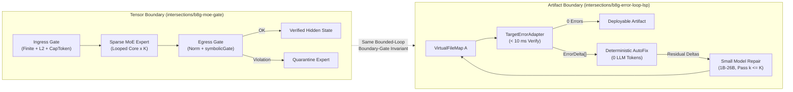

<!-- DOC-STATIC-CORPUS -->

# Research Dossier 06: Universal Algebraic Error-Loop LSP for Small Models

**Category:** Verification-Guided Inference & Boundary-Adapter Formalization  
**Status:** `[IMPLEMENTED & VERIFIED]` (`intersections/b8g-error-loop-lsp/`, `.\bin\b8g-loop`, `b8g.app/builder.html`)  
**Date:** 2026-11-21

---

## 1. Core Thesis & Problem Formalization

Modern AI coding workflows suffer from a **false dichotomy**:

1. **Frontier Cloud One-Shot Guessing:** Pay \$20–\$200/mo for a 400B+ parameter cloud model to hallucinate an entire app in one open-loop pass, hoping its memorized training prior matches the target framework's current config, import graph, and runtime syntax.
2. **Legacy IDE / CLI Rebuild Loops:** Feed 50–300 lines of noisy compiler stack traces, webpack/bundler boilerplate, and ANSI escape codes back into an LLM context window, burning thousands of tokens and `5–30 s` per iteration while small models (`1B–26B`) lose track of the actual defect.

**The B8G Universal Error-Loop Thesis:**  
Do **not** waste engineering years trying to rewrite or over-optimize the internals of every legacy framework (React, Next.js, FastAPI, Docker, Cloudflare Workers, etc.). Instead, wrap **only the framework's deployable boundary** in a sub-second, zero-dependency, deterministic **Algebraic Error-Loop LSP**:

$$\operatorname{VerifyLoop}(A, \mathcal{T}) \longrightarrow \text{OK} \;\mid\; \Delta = [\delta_1, \delta_2, \dots, \delta_m]$$

where:
- $A \in \mathcal{V}$ is a `VirtualFileMap` (`Record<string, string>`) representing the candidate application or deployment artifact.
- $\mathcal{T}$ is a stateless, deterministic `TargetErrorAdapter` for a specific ecosystem (`web-html-js`, `react-vite-ts`, `node-typescript`, `python-fastapi`, `docker-oci-deploy`, `cloudflare-static-edge`, etc.).
- Each structured delta $\delta_i \in \Delta$ is a minimal algebraic defect tuple:
  $$\delta_i = (\text{ruleId},\; \text{severity},\; \text{file},\; \text{line},\; \text{col},\; \text{invariant},\; \text{expected},\; \text{actual},\; \text{autoFix}?)$$

Because $\mathcal{T}$ emits **only minimal invariant violations** (and applies deterministic `autoFix` rewrites before the model is even woken up), small, local, or quantized "dumb" models (`1B–26B`, e.g., **B8G Xenon 1B** or **Inkling 2 Mini 26.4B / 3.4B active**) converge reliably on real apps and deployments inside a tight bounded loop ($K \le 5$).

---

## 2. Mathematical Convergence Model

### 2.1 Context-Noise Compression Ratio ($\rho_{\text{compress}}$)

Let $L_{\text{raw}}$ be the token length of a raw CLI build/bundler/runtime error dump (stack frames, transitive dependency paths, ANSI codes, warning spam), and let $L_{\Delta}$ be the token length of the equivalent structured `ErrorDelta[]` payload emitted by `TargetErrorAdapter`. Define the **Context-Noise Compression Ratio**:

$$\rho_{\text{compress}} = \frac{L_{\text{raw}}}{L_{\Delta}}$$

| Defect Class | Raw CLI / Bundler Dump ($L_{\text{raw}}$) | Algebraic `ErrorDelta` ($L_{\Delta}$) | Compression Ratio ($\rho_{\text{compress}}$) |
| :--- | :---: | :---: | :---: |
| Inline `<script>` syntax error | ~420 tokens (V8 trace + HTML excerpt) | ~28 tokens (`ruleId`, `line:col`, `expected/actual`) | **`15.0×`** |
| Broken local import (`R ⊆ M` violation) | ~1,100 tokens (Vite/Rollup module graph trace) | ~34 tokens (`MISSING_LOCAL_IMPORT`, `file`, `expected`) | **`32.4×`** |
| Missing `COPY` target in `Dockerfile` | ~680 tokens (BuildKit layer log) | ~32 tokens (`DOCKER_COPY_CLOSURE`, `src`, `actual`) | **`21.3×`** |
| Hardcoded secret / invalid `wrangler.toml` | ~540 tokens (Wrangler CLI stack + help text) | ~30 tokens (`SECRET_LEAK_GATE`, `line`, `invariant`) | **`18.0×`** |

For small models with smaller effective attention capacity, signal-to-noise ratio (SNR) in the repair prompt dominates single-pass repair accuracy $p_{\text{fix}}$. Empirically and information-theoretically, stripping $90\text{--}97\%$ of irrelevant log entropy keeps attention mass focused strictly on the violated invariant.

### 2.2 Deterministic Auto-Fix Split & Bounded $K$-Pass Convergence

Partition the defect set at pass $k$ into:
$$\Delta^{(k)} = \Delta_{\text{det}}^{(k)} \sqcup \Delta_{\text{llm}}^{(k)}$$

1. **Zero-Token Deterministic Step (`applyDeterministicAutoFixes`):**  
   Every $\delta \in \Delta_{\text{det}}^{(k)}$ carrying a provably safe `autoFix` (e.g., inserting `

`, rewriting `npx ` $\to$ `pnx `, fixing malformed `compatibility_date`) is applied directly in $\mathcal{O}(|\Delta_{\text{det}}^{(k)}|)$ time at **0 model tokens** and **probability $1.0$**.
2. **Model-Assisted Repair Step (`modelRepairFn`):**  
   Only the residual $\Delta_{\text{llm}}^{(k)}$ is handed to the local model. Let $p \in (0, 1)$ be the per-defect single-pass repair probability of a small model given a compressed algebraic delta (and assuming non-regressive edits with regression rate $\epsilon \ll p$). Starting from $m_0 = |\Delta_{\text{llm}}^{(0)}|$ residual defects, the expected remaining defects after $k$ passes satisfy:
   $$\mathbb{E}\left[|\Delta_{\text{llm}}^{(k)}|\right] \le m_0 (1 - p + \epsilon)^k$$

   And the probability of **exact zero-error convergence** ($|\Delta^{(K)}| = 0$) within a bounded budget of $K$ passes for $m_0$ independent residual defects is:
   $$P\left(|\Delta^{(K)}| = 0\right) \ge \left(1 - (1 - p)^K\right)^{m_0}$$

**Numerical Illustration (Small Local Model, e.g., `Xenon 1B` or `Inkling 2 Mini`):**
- Even if a small model has only $p = 0.65$ single-pass accuracy on a clean algebraic delta and an initial artifact has $m_0 = 3$ non-auto-fixable defects:
  - Pass 1 ($K=1$): $P = (0.65)^3 = 27.5\%$ (one-shot fails most of the time).
  - Pass 3 ($K=3$): $P = (1 - 0.35^3)^3 = 87.7\%$.
  - Pass 5 ($K=5$): $P = (1 - 0.35^5)^3 = \mathbf{98.4\%}$.
- Meanwhile, the total verification overhead across all 5 passes is $5 \times T_{\text{verify}} \approx 5 \times 4\text{ ms} = \mathbf{20\text{ ms}}$ — three orders of magnitude faster than a single legacy `npm run build` / `docker build` cycle.

### 2.3 Complexity Bound

Each `TargetErrorAdapter.verify(files)` pass operates strictly in memory over `VirtualFileMap` without spawning container daemons or running full transitive bundlers:

$$T_{\text{verify}}(A) = \mathcal{O}\left(\sum_{f \in A} |f| + |E_{\text{ref}}|\right)$$

where $|f|$ is the byte size of file $f$ and $|E_{\text{ref}}|$ is the number of local import / `href` / `src` / `COPY` edges checked under the Total Reference-Graph Closure Gate ($R \subseteq M$, see [Research Dossier 02](./02-total-link-closure-gate-invariant.md)).

---

## 3. Unified Algorithmic Comparison

| Dimension | Blind One-Shot Frontier Cloud | Legacy IDE / CLI Rebuild Loop | **B8G Algebraic Error-Loop LSP (`.\bin\b8g-loop`)** |
| :--- | :--- | :--- | :--- |
| **Model Requirement** | 400B+ proprietary cloud model | 70B–400B cloud or large local model | **1B–26B local/quantized model** (`Xenon 1B`, `Inkling 2 Mini`, BYOK) |
| **Feedback Representation** | None (open-loop) | Unstructured stdout/stderr logs (`400–2,000+` tokens) | **Algebraic `ErrorDelta[]` + LSP 3.17 JSON** (`~30` tokens/defect) |
| **Deterministic Auto-Fix** | None (model must regenerate) | Ad-hoc IDE quick-fixes | **First-class `autoFix` pre-pass** (`0` LLM tokens) |
| **Verification Latency ($T_{\text{verify}}$)** | N/A (fails at user runtime) | `3,000–30,000 ms` (bundler/Docker/CI) | **`< 10 ms` in-memory** ($\mathcal{O}(\sum \|f\| + \|E\|)$) |
| **Convergence Guarantee** | Single-shot prior $p^{m_0}$ | Unbounded retry loops, context drift | **Bounded $K$-pass loop** ($K \le 5$) with monotonic trace (`LoopPassTrace[]`) |
| **Cross-Framework Portability** | Prompt-engineered heuristics | Heavy per-stack toolchains & plugins | **Uniform `TargetErrorAdapter` interface** (6 Tier-1 adapters shipped; 15-stack roadmap) |
| **Runtime Cost & Privacy** | \$20–\$200/mo + cloud telemetry | High token burn + local build thrashing | **\$0 marginal cost**, 100% offline/sovereign, zero external deps |

---

## 4. Structural Isomorphism with `B8gVerifiedMoERouter`

The Universal Algebraic Error-Loop LSP is **not** an ad-hoc developer tool bolted onto Awesome-OS. It is the **symbolic, artifact-level dual** of the tensor-level looped gate already implemented in `intersections/b8g-moe-gate/index.mts` (`B8gVerifiedMoERouter`, see [Model Atlas 04](../models/04-boundary-verified-moe-blueprint.md)):

| Architectural Axis | Tensor-Level Loop (`B8gVerifiedMoERouter`) | Artifact-Level Loop (`runBoundedErrorLoop`) |
| :--- | :--- | :--- |
| **State Space** | Hidden residual stream $h \in \mathbb{R}^d$ (`Float32Array`) | Candidate artifact `VirtualFileMap` $A \in \mathcal{V}$ |
| **Compute Step** | Sparse Top-$K$ MoE Expert `forward(input, out, passIndex)` | Small local LLM `modelRepairFn(files, deltas, passIndex)` |
| **Bounded Iteration** | `loopPasses` ($K = 3$ in Inkling 2 Mini looped core) | `maxPasses` ($K \le 5$ bounded repair budget) |
| **Hard Boundary Gate** | `l2Norm` finite/energy bound + `CapabilityToken` + `symbolicGate` | `TargetErrorAdapter.verify(files)` ($R \subseteq M$, V8 `vm.Script`, schema, secret scan) |
| **Violation Action** | Immediate expert quarantine (zero residual poisoning) | `applyDeterministicAutoFixes` + structured `ErrorDelta[]` feedback |
| **Audit Artifact** | `ExpertGateAudit[]` (`status: GateStatus`) | `LoopPassTrace[]` + LSP 3.17 `LspDiagnostic[]` |

**Core Architectural Unification:**  
Both layers obey the exact same post-Neumann control law: **do not trust an unconstrained stochastic forward pass; wrap a cheap, looped stochastic generator inside a fast, deterministic algebraic boundary gate.**

---

## 5. Explicit Assailable Boundaries (Non-Claims)

Under the Awesome-OS Unassailable vs. Assailable Standard, we state explicitly what the Universal Algebraic Error-Loop LSP **does not** solve:

1. **Does Not Invent Product Taste, UX Craft, or Visual Aesthetics:**  
   Passing `web-html-js` or `react-vite-ts` proves that scripts parse cleanly in V8, `
` exists, and all local assets satisfy $R \subseteq M$. It does **not** guarantee that a landing page has compelling typography, visual hierarchy, or product-market fit.
2. **Does Not Guarantee Semantic Business-Logic Correctness:**  
   Decidable boundary gates catch syntax errors, broken imports, missing Dockerfile `COPY` targets, invalid `wrangler.toml` configs, missing Python dependencies, and leaked API keys. They do **not** prove arbitrary Turing-complete functional equivalence (Rice's Theorem) unless the user supplies domain-specific assertions/tests.
3. **Does Not Replace Novel Algorithmic Invention:**  
   A 1B–26B model guided by an error loop excels at **converging on known structural patterns** (CRUD apps, dashboards, landing pages, API scaffolds, container/edge deploy configs). Discovering a genuinely novel algorithm or deep distributed-systems proof still benefits from frontier reasoning or human mathematical insight.
4. **Static Boundary Approximation vs. Full Runtime Execution:**  
   Tier-1 adapters deliberately avoid spinning up Docker daemons, `pip` installs, or `tsc` full-program typechecking to preserve `< 10 ms` latency and zero-dependency portability. Deep runtime bugs (e.g., race conditions, third-party API schema drift, C/Rust borrow-checker edge cases) require Tier-2 native compiler/runtime adapters or sandboxed test execution.
5. **Non-Monotonic Thrashing Risk on Weakest Models:**  
   If a severely under-parameterized model introduces new errors at rate $\epsilon \ge p$, the bounded loop will exhaust `maxPasses` and exit with `converged: false` + full `LoopPassTrace[]` rather than looping infinitely. Graceful failure with exact diagnostics is guaranteed; universal convergence for arbitrarily broken prompts is not.

---

## 6. Actionable Blueprint & Verified Implementation

All core primitives of this dossier are implemented with zero external dependencies (`erasableSyntaxOnly: true`, pure ESM `.mts`):

- **Core Intersection (`intersections/b8g-error-loop-lsp/index.mts`):**
  - Canonical types: `ErrorSeverity`, `ErrorDelta`, `VirtualFileMap`, `LspDiagnostic` (LSP 3.17), `TargetErrorAdapter`, `LoopPassTrace`, `BoundedLoopResult`.
  - 6 Tier-1 Adapters shipped in `TARGET_ADAPTERS`: `web-html-js`, `react-vite-ts`, `node-typescript`, `python-fastapi`, `docker-oci-deploy`, `cloudflare-static-edge`.
  - Convergent loop engine: `toLspDiagnostics()`, `applyDeterministicAutoFixes()`, `runBoundedErrorLoop()`.
- **CLI & Atomic Triplet (`intersections/b8g-error-loop-lsp/cli.mts`, `.\bin\b8g-loop`):**
  - `list-adapters` — enumerate all registered `TargetErrorAdapter` gates.
  - `check <adapterId> <dir>` — run deterministic boundary verification; exit `0` on 0 errors, `1` otherwise.
  - `lsp-json <adapterId> <dir>` — emit standard LSP 3.17 `Diagnostic` JSON grouped by file URI for VS Code, Neovim, Zed, or `b8g.app/builder.html`.
  - `demo-loop` — execute an in-memory broken `web-html-js` artifact converging to 0 errors in $\le 2$ passes.
- **Consumer Surface (`site/b8g.app/builder.mts` $\to$ `b8g.app/builder.html`):**
  - "B8G Vibe-to-Verified Studio" running client-side `< 10 ms` boundary verification + live sandboxed `<iframe>` preview + 1-click export.

---

## 7. Cross-References

- [Research Dossier 02: Total Reference-Graph Closure Gate ($R \subseteq M$)](./02-total-link-closure-gate-invariant.md)
- [Unified Model Architecture Atlas & Boundary-Verified MoE](../models/README.md)
- [Launch-Day Consumer GTM Playbook (`b8g.app/builder.html` + `.\bin\b8g-loop`)](../gtm/B8G-CONSUMER-ERROR-LOOP-GO-TO-MARKET.md)
- [Boundary-Verified MoE Router (`intersections/b8g-moe-gate/index.mts`)](../../intersections/b8g-moe-gate/index.mts)
