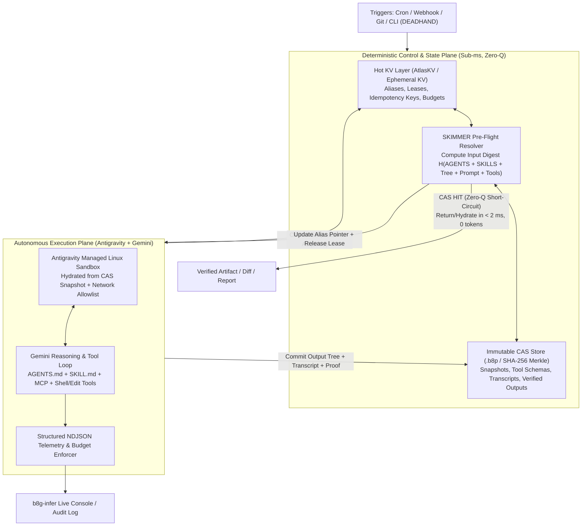

<!-- DOC-STATIC-CORPUS -->

# Zero-Q Autonomous Agent Runner & Platform — Detailed Launch & Function Plan

> **Core Thesis:** Pair **deterministic, sub-millisecond state resolution** (Zero-Q **CAS** + **KV**) directly underneath **non-deterministic, autonomous agent execution** (**Antigravity** managed Linux sandboxes + **Gemini** reasoning & tool loops).
>
> Instead of wrapping `interactions.create` in ad-hoc glue scripts, every agent invocation becomes a **content-addressed, lease-governed, replayable, zero-queue execution contract**.

---

## 1. Identity & Naming Matrix

| Candidate | Vibe & Positioning | Best Fit |
| :--- | :--- | :--- |
| **`ZER0Q`** *(Recommended Primary)* | Sharp, abrupt, zero-latency / zero-queue coldness. | CLI & Platform brand — directly honors the zero-queue, instant-dispatch ethos. |
| **`UNATTENDED`** | Cold, clinical, eerie — agents running while everyone is asleep. | Autonomous trigger daemon / scheduled fleet mode (`zer0q unattended`). |
| **`SUBSTRATE`** | Quietly ominous — the layer underneath reality holding everything together. | Underlying **CAS + KV + Sandbox** state engine (`@awesome-os/substrate`). |
| **`HASHWALKER`** | Uncanny, relentless traversal through content-addressed state. | Workspace Merkle walker & CAS diff/replay engine. |
| **`DEADHAND`** | Automatic trigger firing without a human hand on the wheel. | Event/cron trigger & deterministic fallback recovery controller. |
| **`SKIMMER`** | Fast, frictionless pre-execution skimming of KV/CAS layers. | Pre-flight cache/digest resolver that short-circuits redundant LLM runs. |

> **Recommended Stack Naming:** Platform **`ZER0Q`** powered by **`SUBSTRATE`** (CAS + KV), **`SKIMMER`** (Zero-Q digest short-circuit), and **`DEADHAND`** / **`UNATTENDED`** (autonomous triggers).

---

## 2. Architecture: Control Plane vs. Execution Plane



### Why This Split Matters
1. **Zero wasted tokens on identical states:** If `H(AGENTS.md || SKILL.md || tool_schemas || workspace_merkle_root || prompt || model_config)` already has a valid verified artifact in CAS, `SKIMMER` hydrates and returns it in **< 2 ms** with **0 LLM calls** and **0 sandbox boot time**.
2. **Zero queue stalls:** Dispatch uses optimistic KV leases (`SETNX` / atomic CAS compare-and-swap) with idempotency keys rather than heavyweight broker queues.
3. **Deterministic replay & forensics:** Every autonomous run is 100% reproducible because its exact inputs (`AGENTS.md`, `SKILL.md`, repo tree, tool manifest) are pinned by immutable SHA-256 CAS hashes.

---

## 3. Core Platform Functions & Capabilities

### 3.1 Immutable CAS Layer (`SUBSTRATE-CAS`)
- **Content-Addressed Bundles (`.b8p` / SHA-256):**
  - `instructions_hash`: Canonical hash of `AGENTS.md` + all resolved `SKILL.md` files + system rules.
  - `toolchain_hash`: Canonical hash of MCP server schemas, tool definitions, and container image digest.
  - `workspace_hash`: Merkle root of the target repository/sandbox filesystem (`UniversalVersionedSource`).
  - `input_digest`: `SHA256(instructions_hash || toolchain_hash || workspace_hash || prompt_canonical || model_id || policy_hash)`.
- **Verified Output Objects:**
  - `output_tree_hash` (resulting file diff / patch / build artifact bundle).
  - `transcript_hash` (full structured tool-call & reasoning trace).
  - `verification_hash` (exit codes, test outputs, invariant gate proofs).
- **Garbage Collection & Pinning:** Reference-counted GC protecting any CAS object referenced by an active KV alias, audit retention window, or lease.

### 3.2 Sub-Millisecond KV Layer (`SUBSTRATE-KV`)
- **Mutable Aliases → Immutable CAS Hashes:**
  - `alias:issue-solver:prod` → `cas:sha256:9f3a...` (atomic pointer swap = instant zero-downtime rollout & instant rollback).
- **Active Sandbox Leases & Heartbeats:**
  - `lease:run:<run_id>` → `{ sandbox_id, owner, started_at, ttl_ms, heartbeat_ts }`.
  - Automatic orphan reclamation if a worker dies without releasing its lease.
- **Trigger Idempotency & Deduplication:**
  - `idem:<trigger_id>:<event_digest>` → prevents duplicate GitHub webhooks or overlapping cron ticks from spawning twin runs.
- **Live Budget & Rate-Limit Counters:**
  - Per-agent / per-tenant token ceilings, USD spend caps, max tool iterations, and wall-clock deadlines enforced in real time on every tool-loop turn.

### 3.3 First-Class Runner Contract (Declarative Job Manifest)
Every run is submitted as a typed manifest (`zer0q.job.json` / `.mts`), never an untyped prompt string:

```json
{
  "apiVersion": "zer0q.awesome-os/v1",
  "name": "nightly-security-audit",
  "alias": "sec-audit:latest",
  "inputs": {
    "agentsMd": "cas:sha256:...",
    "skills": ["cas:sha256:..."],
    "workspace": "uvs:merkle:...",
    "prompt": "Audit auth boundaries and open a verified patch."
  },
  "execution": {
    "model": "gemini-2.5-pro",
    "sandbox": {
      "image": "antigravity/linux-minimal:v2",
      "networkAllowlist": ["github.com", "generativelanguage.googleapis.com"],
      "cpuLimit": 4,
      "memoryMb": 8192
    },
    "cachePolicy": "zero-q-lookup-or-run",
    "maxTokens": 250000,
    "maxWallSeconds": 600,
    "maxRetries": 2
  },
  "verification": {
    "commands": ["pnpm test --filter auth"],
    "requireZeroExit": true
  }
}
```

### 3.4 Execution Lifecycle & Failure Semantics
- **State Machine:** `DISPATCHED → CAS_CHECK → (CACHE_HIT | LEASED → HYDRATING → RUNNING → VERIFYING → COMMITTED | FAILED | TIMED_OUT | KILLED)`.
- **Clean Retry Semantics:**
  - Transient infra/rate-limit errors (`429`, `503`, sandbox preemption) retry with exponential backoff under the same idempotency key.
  - Deterministic verification failures (failing unit tests, budget exceeded) commit the partial transcript to CAS for inspection without burning infinite retries.
- **Deterministic Replay (`zer0q replay <run_id>`):** Re-hydrates the exact `workspace_hash` + `instructions_hash` into a fresh sandbox to reproduce, diff, or test a newer Gemini model against the exact historical snapshot.

### 3.5 CLI, API & Observability Surface
- **CLI (`zer0q` / `.\bin\zer0q.ps1`):**
  - `zer0q run <manifest>` — Zero-Q CAS lookup + dispatch + live streaming NDJSON events.
  - `zer0q lookup <manifest>` — Dry-run `SKIMMER` digest check (returns CAS hit/miss in < 2 ms).
  - `zer0q alias set|get|rollback <name> <cas_hash>` — Instant atomic pointer management.
  - `zer0q replay <run_id> [--model <new_model>]` — Deterministic A/B replay from CAS.
  - `zer0q trigger add|list|fire <cron|webhook|git>` — Manage `DEADHAND` / `UNATTENDED` triggers.
  - `zer0q leases` / `zer0q kill <run_id>` — Live lease table & hard kill switch.
- **Live Observability (`b8g-infer` Integration):**
  - Every `zer0q` run streams structured events (`cas_hit`, `lease_acquired`, `tool_call`, `budget_tick`, `verify_pass`, `cas_commit`) directly into `intersections/inference-manager` (`.\bin\b8g-infer.ps1`).

---

## 4. Phased Launch Plan

### Phase 0 — Canonical Digest & Storage Contract (Week 1)
- [ ] **P0.1** Define `zer0q.job.v1` TypeScript schema & canonical JSON serializer (deterministic key ordering for stable SHA-256 digests).
- [ ] **P0.2** Implement `SUBSTRATE-CAS` adapter over Awesome-OS `.b8p` CAS packs + SHA-256 content store (put/get/has/verify/pin).
- [ ] **P0.3** Implement `SUBSTRATE-KV` adapter (in-process/local `AtlasKV` + pluggable Redis/FoundationDB/Cloudflare-KV-compatible interface) with atomic `CAS` (`compareAndSwap`), TTL leases, and alias pointers.
- [ ] **P0.4** Unit tests proving deterministic digest stability across OSes and sub-millisecond `SKIMMER` lookup (`< 1 ms` local).

### Phase 1 — Single-Agent Zero-Q Runner MVP (Week 2)
- [ ] **P1.1** Build `zer0q run` and `zer0q lookup` CLI commands.
- [ ] **P1.2** Wire `Antigravity` managed Linux sandbox hydration from `workspace_hash` + `AGENTS.md`/`SKILL.md` injection + network allowlist enforcement.
- [ ] **P1.3** Wire `Gemini` tool loop with streaming NDJSON telemetry, live token/wall-time budget enforcement, and post-run verification gate.
- [ ] **P1.4** End-to-end proof: Run #1 executes in sandbox & commits to CAS; Run #2 with identical manifest hits **Zero-Q CAS short-circuit** in `< 5 ms` (`0` tokens burned).

### Phase 2 — `DEADHAND` Triggers, Leases & Idempotency (Week 3)
- [ ] **P2.1** Implement `DEADHAND` trigger daemon (`cron`, GitHub webhook, local file/CAS-diff watcher) with KV idempotency keys.
- [ ] **P2.2** Implement lease heartbeat watchdog + automatic orphan sandbox reaper.
- [ ] **P2.3** Implement `zer0q alias` atomic promotion & one-command rollback across agent versions (`AGENTS.md` + `SKILL.md` bundles).
- [ ] **P2.4** Implement `zer0q replay <run_id>` for deterministic debugging & model A/B regression testing.

### Phase 3 — Multi-Agent Fleet, `b8g-infer` Console & Security Hardening (Week 4)
- [ ] **P3.1** Wire live `zer0q` NDJSON event stream into `intersections/inference-manager` (`b8g-infer`) for real-time lease, budget, CAS-hit-ratio, and kill-switch visibility.
- [ ] **P3.2** Add capability-token tenant isolation (`CapabilityToken` from `sections/atlas-kv`) so multi-tenant KV/CAS namespaces cannot cross-read cached artifacts.
- [ ] **P3.3** Enforce secret redaction before CAS commit (prevent API keys/tokens from ever being persisted in immutable transcripts or snapshots).
- [ ] **P3.4** Benchmark & publish launch telemetry: CAS hit latency, cache-hit token savings %, cold-start vs warm-hydrated sandbox boot time, and unattended trigger reliability.

### Phase 4 — Public Launch & Developer Onboarding (Week 5)
- [ ] **P4.1** Ship 3 turnkey starter manifests (`pr-reviewer`, `nightly-dep-auditor`, `incident-triager`) with pre-hashed `SKILL.md` bundles.
- [ ] **P4.2** Publish interactive quickstart notebook (`.\bin\notebook.ps1`) + architecture story visualization (`intersections/b8g-video`).
- [ ] **P4.3** Open-source `zer0q` manifest spec + `SUBSTRATE` CAS/KV reference driver.

---

## 5. Launch Success Metrics (KPIs)

| Metric | Target at Launch |
| :--- | :--- |
| **Zero-Q CAS Hit Latency (`p99`)** | `< 2 ms` local / `< 15 ms` edge |
| **Token Cost Reduction on Repeat/CI Runs** | `> 60%` via `SKIMMER` CAS short-circuit |
| **Duplicate Trigger Executions** | `0` (enforced via KV idempotency keys) |
| **Orphaned Sandboxes After Worker Crash** | `0` (reaped within `2×` lease TTL) |
| **Replay Fidelity** | `100%` bit-identical input hydration from CAS |
| **Secret Leakage into CAS** | `0` (mandatory pre-commit redaction scanner) |
